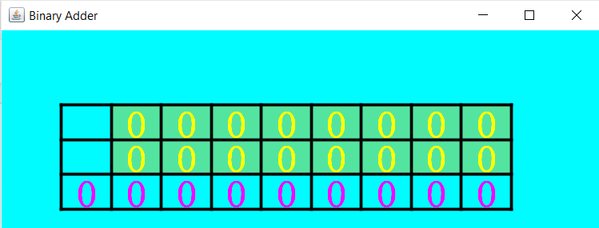
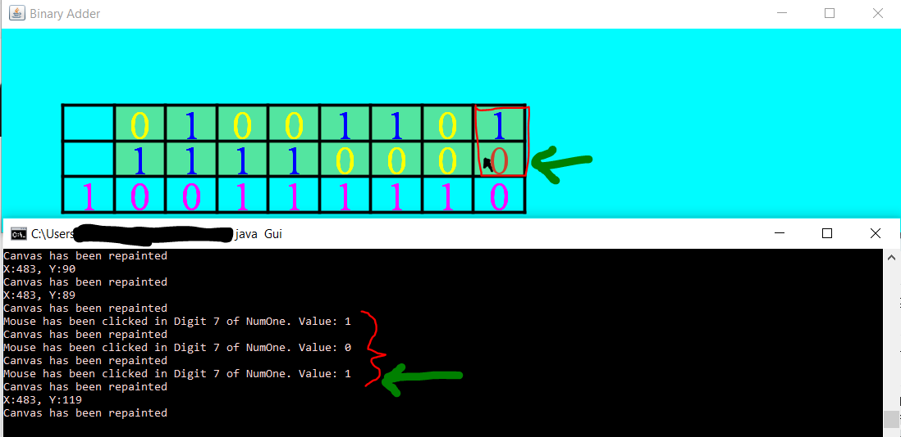

## Starting screen upon running the program  
* The top two rows are user-input numbers, in binary.
* The bottom row is the result of adding, place-value-wise, the two rows above it.
* Editable/Clickable bits (the top two rows) have a green background per rectangular cell.
* The last (i.e., bottom) row has an extra bit at the end to accommodate overflow, and there is a noticeable lack of displayed bits in the same column two rows above that overflow bit, signifying that the user is not meant to directly alter that overflow bit.
* 
 
 

## During usage of the program  
* User is hovering their mouse cursor over the Least Significant Bit of the second binary number to add, causing a brown highlight on that bit while the remaining bits, across both binary numbers, are blue for bitValue1 and yellow for bitValue0:
* 
 
 

## Compiling and Running the program  
1) 
* First, ensure that Java is both downloaded *and* installed.
* Next, ensure that your Windows `Environment Variables`->`User variables for <YOUR-COMPUTER-USERNAME>` is configured to be able to locate the executable of Java (i.e., `java.exe`) from the Java installation you've already downloaded (not included in this project).
2) 
* Ensure both this project's files (CustomPanel.java, Gui.java) are placed in the same folder as each other.
* Open the Windows `Command Prompt` application in that folder by navigating to where those two Java files are, then click on whitespace within `File Explorer`'s Address Bar, then type `cmd`, then press `ENTER` on your keyboard to open up Command Prompt.
* Next, type the following commands (do not type them out of order):
* `javac Gui.java`
* `java Gui`
* 
 
